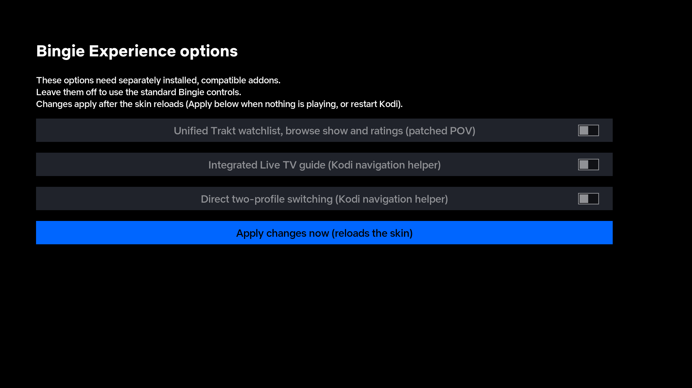

# Bingie Experience

An independently maintained fork of the Netflix-style **Bingie** skin for Kodi, with improvements to everyday TV navigation, trailer previews and playback.

Built on [Matke's Bingie](https://github.com/matke-84/skin.bingie) and [BigMoco's fork](https://github.com/Bigmoco/skin.bingie). Their history, attribution and GPL v2 license are preserved.

**Version 2.0.2.6** · [Download](https://github.com/glasgowm148/skin.bingie/releases/latest) · [Issues](https://github.com/glasgowm148/skin.bingie/issues) · [Changelog](CHANGELOG.md)

## What we've added

These improvements work with the normal Bingie dependencies:

- **Playback-safe previews.** Moving focus or leaving a hub stops only a trailer preview started by the skin, preserving videos you started yourself. Previews wait while ordinary media is playing or paused.
- **Pause and information fixes.** Automatically opened pause information closes when playback resumes. Deliberately opened information stays open; opening cast or crew from the pause screen preserves playback.
- **Crew recommendations.** Director, creator and writer rows wait for a valid person ID. Episodes no longer request director results from unrelated information tabs.
- **Episode and season navigation improvements.** Revised views, focus behavior and information presentation.
- **Widget and artwork refinements.** Layout and artwork-loading adjustments. Skin Shortcuts rebuilds wait until Home is opened with nothing playing.
- **BigMoco's keyboard layout**, retained alongside reviewed Matke updates.
- **Movie and TV title suggestions.** The Bingie search screen uses TMDb Bingie Helper's movie/TV results for autocomplete, replacing unrelated Google web suggestions. Selecting a suggestion fills its title into search. The general virtual keyboard retains its own Autocompletion settings.

Optional Experience controls support compatible companion add-ons:

| Addition | Requirement |
| --- | --- |
| Add/Remove Watchlist controls, `+` indicator, Browse Show and rating actions | POV with the companion `manager_*` routes; ordinary POV does not provide them |
| Integrated Live TV guide, search, day navigation and channel-group hub rows | Custom `script.kodi.live.tv` navigation helper and configured PVR |
| Direct two-profile switching with a progress overlay | The same navigation helper and its profile-switch implementation |
| Keep waiting / Try another stream prompt | Playback-recovery add-on supplying the documented window properties |

The three Experience settings **default off** and preserve standard controls when integrations are unavailable. The recovery prompt stays dormant without its integration. **Companion patches, navigation helpers and Android workarounds are not included in this release.** Their skin-side contracts are in [Optional integrations](docs/integrations.md); installing an add-on with the right name alone does not supply them.



*Generic Kodi 21 CI screenshot with stubbed Bingie helpers; no personal library or household configuration.*

## Install

This fork uses the existing **`skin.bingie`** ID and replaces another Bingie version.

1. Back up your current skin, skin settings and Skin Shortcuts data; keep the previous skin ZIP for rollback.
2. Configure the repositories supplying Bingie's dependencies. [Matke's Bingie repository](https://github.com/matke-84/repository.bingie) is the upstream starting point. [addon.xml](addon.xml) lists required versions of Bingie Helper, Toolbox, Widgets, TMDb Bingie Helper, Skin Shortcuts, studio artwork and Autocompletion.
3. Download **`skin.bingie-2.0.2.14.zip`** from [Releases](https://github.com/glasgowm148/skin.bingie/releases/latest). GitHub's automatic **Source code** archives are not the installable package.
4. In Kodi, allow installation from unknown sources if prompted, then use **Settings → Add-ons → Install from zip file**. Select Bingie Experience under **Settings → Interface → Skin**.
5. Check Home, Movies, Shows, episode/season views, the guide and playback. Enable supported integrations under **Configure Skin → Experience options**. Settings are per profile; use Apply while playback is idle to reload the skin.

Kodi Manager is optional. The package contains skin files and the license; it does not configure accounts, playlists, EPG services, providers or personal layouts.

For future updates, install the next release ZIP using the same steps. This GitHub project does not supply a Kodi automatic-update repository. See Kodi's [official ZIP installation guide](https://kodi.wiki/view/Add-on_manager#How_to_install_from_a_ZIP_file) for the installation screens.

To roll back, switch to Estuary, reinstall the previous Bingie ZIP and restore backed-up skin/Skin Shortcuts settings if needed. Reinstalling the skin alone does not restore a saved layout.

## Compatibility and testing

- Requires the **Kodi 21 / Omega skin API** (`xbmc.gui` 5.17.0) and dependencies in `addon.xml`.
- Version 2.0.2.7 is installed on the reference NVIDIA Shield (15 Oct: loads with no condition-parse errors). Version 2.0.2.6 was installed on the reference NVIDIA Shield (Android 11, Kodi 22 RC1). Episode details with missing director IDs, a valid director query, helper search, profile switching and local-video playback controls passed. A separate BBC-episode trailer lookup failed; this release does not claim to fix all helper/provider errors.
- Earlier testing of 2.0.2.5 on that Shield confirmed the search behavior: The native search screen displayed South Park first for `sout`; a read-only query through the installed helper also returned it first for `south`. Empty input showed the search categories without opening an input dialog.
- GitHub CI checks XML, includes, textures, stock fallbacks and playback guards on Python 3.9, 3.10 and 3.12, plus reproducible ZIP builds.
- Headless Kodi 21 rendering has passed. Stubbed Bingie helpers leave widgets empty; this checks skin loading and screens rather than provider/account behavior. Other devices and companion combinations need runtime testing.
- A profile literally named **Kids** uses the curated **Little Ones** and **Cartoons** PVR hub groups. Missing groups leave those rows empty; see [integration details](docs/integrations.md).

Both tracked upstream `omega` branches were fully merged on 2026-10-12: Matke `9f1c6eb` and BigMoco `c960cbb`. [UPSTREAM_BASE](UPSTREAM_BASE) records revisions; [upstream maintenance](docs/upstream.md) describes future reviews.

## Build and contribute

Python 3.9+; the build and unittest suite need no third-party packages:

```sh
python scripts/check_skin.py
python -m unittest discover -s tests -q
python scripts/build_skin.py
```

The installable ZIP and SHA-256 file go into `dist/`. Development tools, screenshots, user profiles and generated Skin Shortcuts menus are excluded. Checks reject private LAN addresses, emails and URL credentials in shipped text.

Bug reports should include Kodi/device/skin versions, enabled Experience options, reproduction steps and relevant redacted logs. Pull requests are welcome: retain credits, keep integrations optional with stock fallbacks, and run the checks. Provider/account and Android patches belong in separate projects.

## Credits and license

Bingie by **Matke**, with **BigMoco's** modifications and this fork maintained by **glasgowm148**. Independent community fork. **GPL v2.0**: [LICENSE](LICENSE). [Original README](README.upstream.md).
